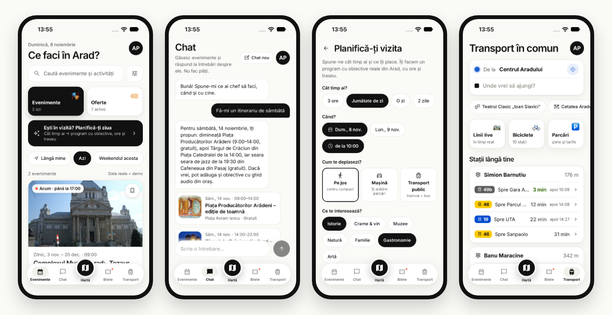
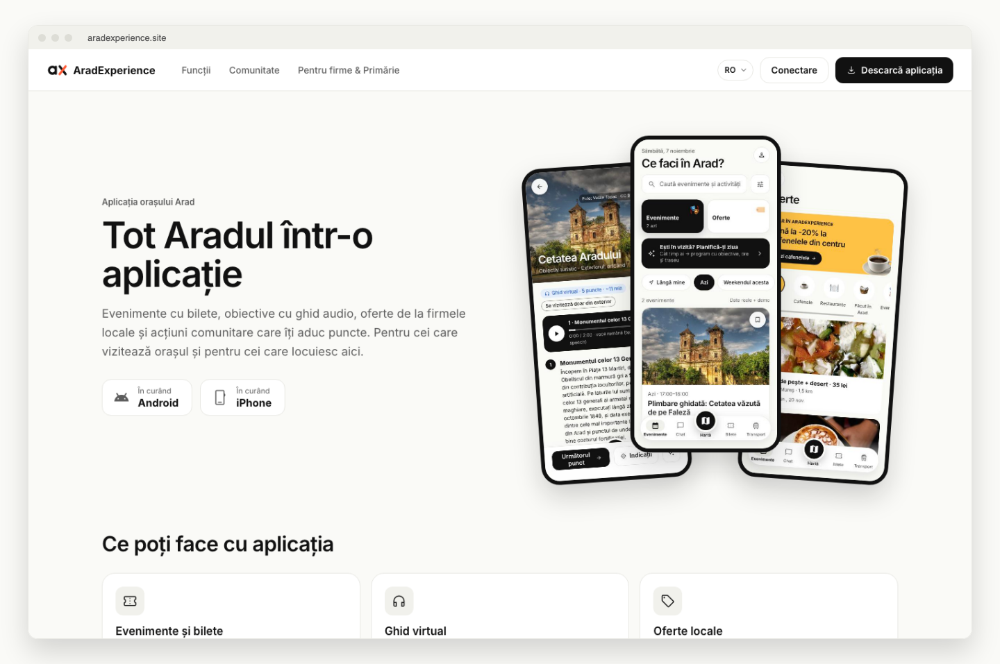
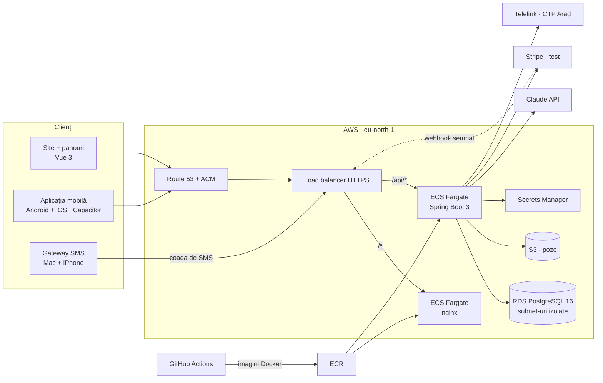

<div align="center">

<picture>
  <source media="(prefers-color-scheme: dark)" srcset="https://raw.githubusercontent.com/HACK4ARAD/.github/main/profile/assets/logo-dark.png">
  
</picture>

# AradExperience

**Arad, într-o singură aplicație.**

Evenimente și bilete · ghid audio la obiective · transport în comun live · oferte locale · o comunitate în care faptele bune aduc puncte · un asistent AI care îți face traseul

[](https://aradexperience.site)


*Arad in one app — events and tickets, audio guides, live public transport, local offers, a points-based community and an AI trip planner. Built in two days at Hack4Arad 2026.*

</div>



## Încearc-o acum

1. Deschide **[aradexperience.site](https://aradexperience.site)** → **Conectare** → **„Intră ca vizitator”** (fără cont, fără cod).
2. În aplicația de telefon, numerele demo **0799 000 001** (Vizitator) și **0799 000 002** (Localnic) primesc codul direct pe ecran.
3. Biletele se plătesc cu Stripe în **modul de test**: cardul `4242 4242 4242 4242`, orice dată viitoare, orice CVC. Nu se încasează bani.
4. API-ul e documentat live în **[Swagger](https://aradexperience.site/swagger-ui.html)**.

## Ce face, pe roluri

| Rol | Ce poate face |
|---|---|
| **Vizitator** | caută evenimente, cumpără bilete cu cod QR (merg și offline), ascultă ghidul audio la obiective, cere asistentului AI un program („am 4 ore, pe jos, istorie și o cafea”), urmărește traseul pe hartă |
| **Localnic** | tot ce face vizitatorul, plus acțiuni pentru oraș (plantări, curățenie, donare de sânge) care aduc puncte, clasamentul lunii și plata cu puncte la cafenelele și magazinele partenere |
| **Firmă** | panou web: oferte și evenimente, validarea codurilor la casă, recenzii |
| **Primărie** | panou web: agenda orașului, obiective și ghiduri audio, acțiuni comunitare, validarea participării prin QR, voluntari, firme partenere, clasament |
| **Voluntar** | în aplicație: acțiunile la care e repartizat, scanarea codurilor, mesaje cu coordonatorul |
| **Admin** | moderare conținut, utilizatori, setări |

Aplicația e în **română, engleză și maghiară**.



## Arhitectura



- **Deploy continuu:** un merge pe `main` rulează testele, construiește imaginea, o pune în ECR și face rolling deploy pe ECS (~5–8 minute), cu revenire automată dacă pică.
- **Infrastructura e cod:** totul e în Terraform, 7 module (rețea, DNS, date, API, web, monitorizare, deploy), cu alarme CloudWatch și buget pe e-mail.
- **Rețea:** baza de date stă în subnet-uri fără rută spre internet și acceptă conexiuni doar de la API, prin TLS.

## Părțile interesante

<details>
<summary><b>Asistentul AI (Claude)</b>: chat și planificator de vizită</summary>

- Chatul răspunde **doar din catalogul real**: evenimentele din următoarele 14 zile și obiectivele cu ghid. Id-urile pe care le întoarce modelul sunt filtrate pe server, ca să nu apară evenimente inventate.
- Planificatorul cere modelului doar **ce opriri** să aleagă. Orele, drumurile (pe jos, mașină cu parcare, transport public) și încadrarea în program le calculează backend-ul. O zi se termină cel târziu la 22:00.
- Răspunsurile vin ca JSON validat după schemă (structured outputs). Fără Claude, ambele au un **mod offline** care răspunde din aceleași date.
- Model: `claude-haiku-5-5`, cu limită de cereri pe adresă.
</details>

<details>
<summary><b>Login cu SMS de pe un iPhone</b>: gateway-ul propriu</summary>

- Codul de login (OTP) se generează în API, se păstrează doar ca hash, iar SMS-ul intră într-o coadă.
- Un script pe un Mac ia SMS-urile din coadă la 3 secunde, cu un token secret, și le trimite prin aplicația Mesaje, de pe iPhone. Mac-ul doar întreabă API-ul: nu are porturi deschise.
- Protecții: un cod pe minut și 5 pe zi pe număr, limite pe adresă și globale pe oră și pe zi, 5 încercări pe cod, reîncercare automată dacă trimiterea pică, SMS-uri expirate dacă nu pleacă în 4 minute.
- Cod: [AradEx-Ops/sms-gateway](https://github.com/HACK4ARAD/AradEx-Ops/tree/main/sms-gateway).
</details>

<details>
<summary><b>Plăți cu Stripe</b> (modul de test)</summary>

- API-ul creează un PaymentIntent; formularul de card e Stripe.js, deci datele cardului nu trec prin serverele noastre.
- Biletul se emite după ce API-ul verifică plata la Stripe. Webhook-ul `payment_intent.succeeded` (semnătură HMAC) îl emite și dacă aplicația s-a închis imediat după plată. Un PaymentIntent dă un singur bilet.
</details>

<details>
<summary><b>Transport în comun live</b></summary>

- Rețeaua CTP Arad: 29 de linii și 299 de stații, din datele publice. Vehiculele și sosirile vin live din Telelink, cu cache de 25 de secunde.
- Planificatorul de drum: „spre Cetate” îți arată linia, stația și când vine tramvaiul.
</details>

<details>
<summary><b>Securitate</b></summary>

- Autentificare JWT, roluri verificate pe fiecare rută (`SecurityConfig`, testat).
- Cheile (JWT, Claude, Stripe, Twilio, gateway) stau în AWS Secrets Manager și ajung în containere ca variabile; **niciuna nu e în git**.
- Bucket-ul de poze e privat și criptat; pozele se servesc prin API.
- CI-ul rulează doar la push pe `main`, nu din PR-uri externe.
</details>

## Codul

| Repo | Ce e | Tehnologii |
|---|---|---|
| [AradEx-Frontend](https://github.com/HACK4ARAD/AradEx-Frontend) | site-ul (prezentare + panouri) și aplicația mobilă, două build-uri separate din același cod | Vue 3 · TypeScript · Vite · Tailwind 4 · Pinia · Capacitor · Google Maps / Leaflet · Vitest |
| [AradEx-Backend](https://github.com/HACK4ARAD/AradEx-Backend) | API-ul REST: modulul `api` (contractul) și `app` (aplicația) | Spring Boot 3 · Java 21 · PostgreSQL 16 · Flyway · Spring Security + JWT · Anthropic SDK · JUnit / Mockito |
| [AradEx-Infrastructure](https://github.com/HACK4ARAD/AradEx-Infrastructure) | producția pe AWS și Postgres local | Terraform · ECS Fargate · RDS · ALB · Route 53 · S3 · Secrets Manager · CloudWatch |
| [AradEx-Ops](https://github.com/HACK4ARAD/AradEx-Ops) | gateway-ul de SMS și agenții | Node.js · AppleScript · launchd |
| [AradEx-Plan](https://github.com/HACK4ARAD/AradEx-Plan) | planul și documentația, plus designul | Markdown · prototipuri HTML |

Documentația, în `AradEx-Plan/docs`:
- [API.md](https://github.com/HACK4ARAD/AradEx-Plan/blob/main/docs/API.md) — contractul REST
- [DATA-MODEL.md](https://github.com/HACK4ARAD/AradEx-Plan/blob/main/docs/DATA-MODEL.md) — tabele și migrări
- [FEATURES.md](https://github.com/HACK4ARAD/AradEx-Plan/blob/main/docs/FEATURES.md) — regulile pe roluri
- [DEPLOY.md](https://github.com/HACK4ARAD/AradEx-Plan/blob/main/docs/DEPLOY.md) — producția
- [ARAD-DATA.md](https://github.com/HACK4ARAD/AradEx-Plan/blob/main/docs/ARAD-DATA.md) — datele reale despre Arad
- [STATUS.md](https://github.com/HACK4ARAD/AradEx-Plan/blob/main/docs/STATUS.md) — starea fiecărui task și deciziile

Designul e în [design/final](https://github.com/HACK4ARAD/AradEx-Plan/tree/main/design/final).

## Rulează local

Ai nevoie de JDK 21, Node 20+ și Docker.

```bash
mkdir -p ~/HACK4ARAD && cd ~/HACK4ARAD
git clone https://github.com/HACK4ARAD/AradEx-Plan.git && cd AradEx-Plan && ./setup.sh   # clonează celelalte repo-uri alături
(cd ../AradEx-Infrastructure && docker compose up -d)                                      # PostgreSQL 16
(cd ../AradEx-Backend && cp .env.example .env && ./gradlew :app:bootRun)                   # API: http://localhost:8080/swagger-ui.html
(cd ../AradEx-Frontend && cp .env.example .env && npm install && npm run dev)              # site: http://localhost:5173
(cd ../AradEx-Frontend && npm run dev:mobile)                                              # aplicația, în browser: http://localhost:5174
```

Baza se umple singură la pornire cu datele demo, din migrările Flyway. Cheia Claude și cheile Stripe sunt opționale: fără ele, asistentul răspunde offline, iar plata e demonstrativă.

## În cifre

| | |
|---|---|
| construită în | **2 zile**, la Hack4Arad 2026 |
| endpoint-uri REST | **113** |
| migrări Flyway | **32** (schemă + date reale despre Arad) |
| teste | **~760** în backend · **~340** în frontend |
| roluri | **6** |
| limbi | **3**: română, engleză, maghiară |

## Echipa

[ZOCZELI](https://github.com/ZOCZELI) · [LukasL2004](https://github.com/LukasL2004) · [vaidaoctav](https://github.com/vaidaoctav) · [DamAndrei04](https://github.com/DamAndrei04)

## Drepturi de autor

© 2026 Echipa AradExperience (Hack4Arad 2026). **Toate drepturile rezervate.** Codul e public doar ca să poată fi văzut; copierea, modificarea sau folosirea lui în alt proiect cer acordul nostru scris (detalii în fișierul `LICENSE` din fiecare repo). *Copyright © 2026 the AradExperience team. All rights reserved.*

<sub>Pozele obiectivelor și ale ofertelor: Wikimedia Commons (CC BY / CC BY-SA / domeniu public); autorii și licențele, în [AradEx-Plan/design](https://github.com/HACK4ARAD/AradEx-Plan/blob/main/design/README.md). Datele despre transport: CTP Arad.</sub>
